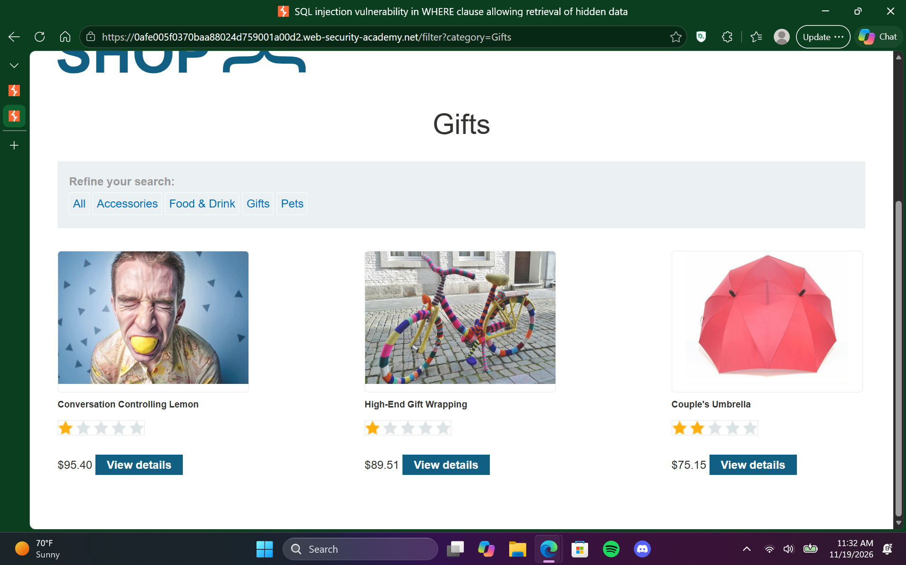
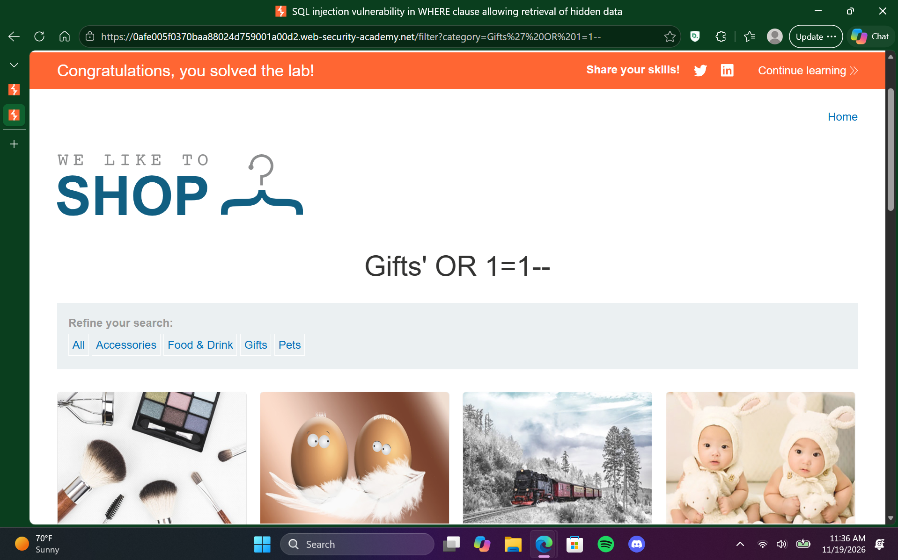

# Lab 1: SQL Injection — Hidden Data Retrieval

## Objective
Demonstrate how a SQL injection vulnerability in a product-category filter can bypass query restrictions and reveal hidden products.

**Platform:** PortSwigger Web Security Academy  
**Lab:** SQL Injection Vulnerability in WHERE Clause Allowing Retrieval of Hidden Data  
**Status:** Completed

## Initial Observation
The application displayed products based on a category selected by the user. When I selected the `Gifts` category, the URL included the parameter `?category=Gifts`, and three products were displayed.

The underlying SQL query was structured as follows:

```sql
SELECT * FROM products
WHERE category = 'Gifts'
AND released = 1;
```

## Testing the Vulnerability

I modified the category parameter using the following payload:

```sql
Gifts' OR 1=1--
```

The single quotation mark closed the original SQL string, `OR 1=1` introduced an always-true condition, and `--` commented out the remainder of the query.

This bypassed the original category and release restrictions.

## Results
After submitting the modified parameter, the application displayed products from multiple categories instead of only the selected category.

PortSwigger confirmed that the lab was successfully solved.

## Security Impact
This lab demonstrated how SQL injection can manipulate database queries and expose information that should otherwise remain restricted.

## Evidence

### Before Injection


### After Injection


## Key Takeaway
This exercise reinforced the importance of separating user input from executable SQL queries. Parameterized queries can prevent user-supplied values from changing the intended SQL structure.
