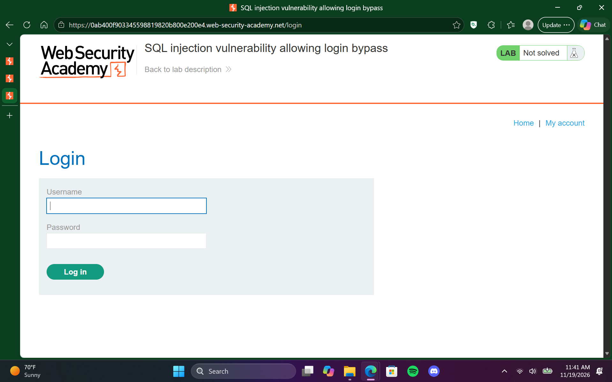
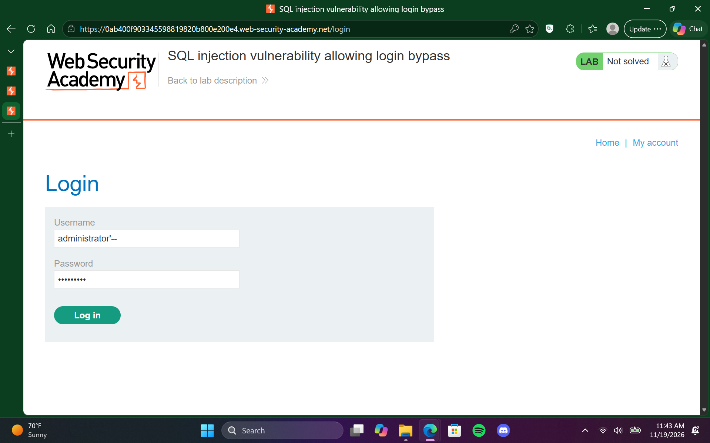
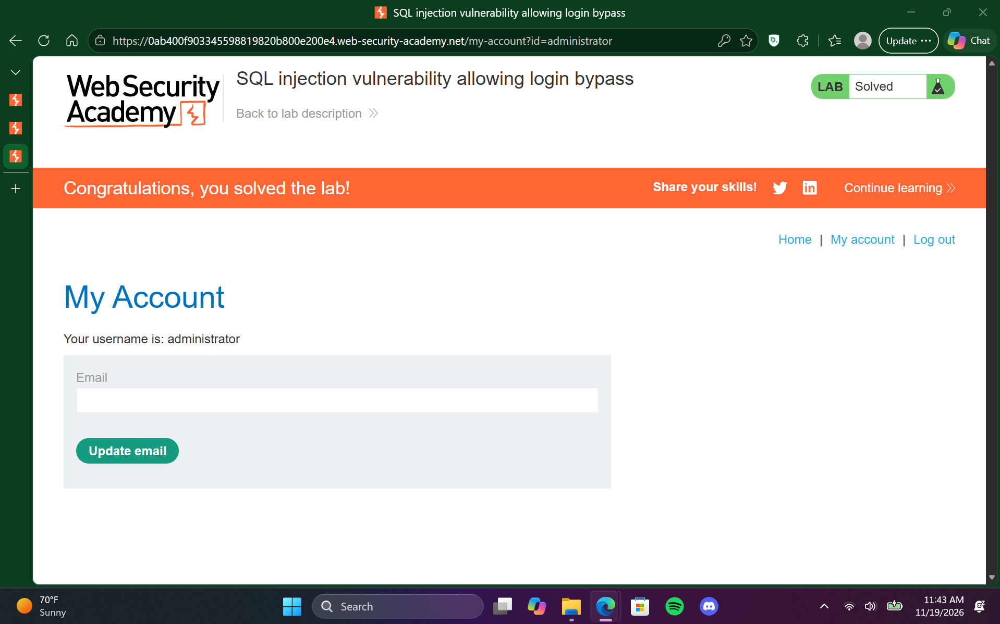

# Lab 2: SQL Injection — Authentication Bypass

## Objective

Demonstrate how a SQL injection vulnerability in a login form can bypass password verification and allow unauthorized access to an administrator account.

**Platform:** PortSwigger Web Security Academy  
**Lab:** SQL Injection Vulnerability Allowing Login Bypass  
**Status:** Completed

## Initial Observation

The application contained a login form requiring a username and password for authentication.

Under normal circumstances, both credentials should be verified before a user is granted access to their account.

A simplified SQL query representing this authentication process is shown below:

```sql
SELECT * FROM users
WHERE username = 'administrator'
AND password = 'test123';
```

*Note: This is an illustrative query, not the application's verified backend source code.*

## Testing the Vulnerability

I entered the following SQL injection payload into the username field:

```sql
administrator'--
```

I then entered an arbitrary password and submitted the login form.

**Payload breakdown:**

- `administrator` — Specifies the account being targeted.
- `'` — Closes the original SQL string.
- `--` — Comments out the remaining SQL query, including the password verification condition.

This manipulated the intended authentication query so that the password condition was no longer evaluated.

## Results

After submitting the modified username, the application authenticated me as the administrator despite the arbitrary password.

The resulting account page displayed:

- The authenticated username: `administrator`
- Access to the administrator's account page
- PortSwigger's confirmation that the lab was successfully solved

## Security Impact

This exercise demonstrated how SQL injection vulnerabilities can compromise authentication controls.

If an application constructs authentication queries using unsafely incorporated user input, an attacker may be able to manipulate the query to gain unauthorized access without knowing the account's password.

## Evidence

### 1. Before Injection
The application initially presented a login form
requiring a username and password.



### 2. SQL Injection Payload
I entered `administrator'--` in the username field
and an arbitrary password to test whether the
password verification condition could be bypassed.



### 3. Successful Authentication Bypass
The application authenticated the administrator account
without validating the supplied password. PortSwigger
confirmed successful completion of the lab.



## Key Takeaway

This lab reinforced the importance of securely handling user input in authentication systems. Parameterized queries help prevent SQL injection by ensuring user-supplied values cannot alter the structure of SQL statements.

Combined with the hidden-data retrieval lab, this exercise demonstrated two distinct consequences of SQL injection: exposure of restricted information and authentication bypass.
